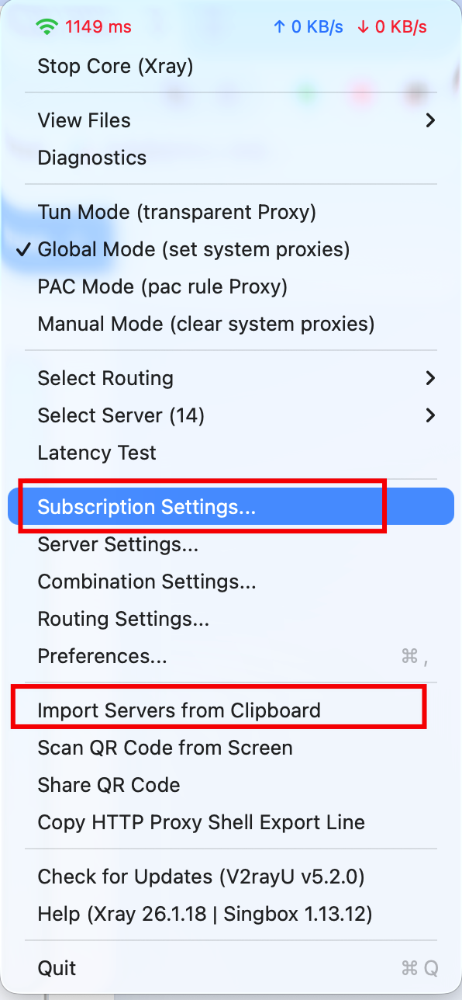
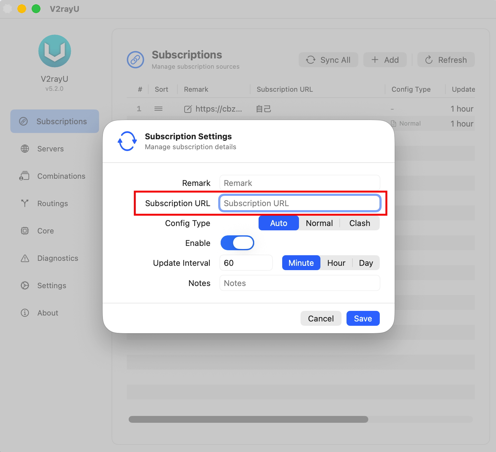

# 2026 Just My Socks Registration and Purchase Guide: Plans, Payment, and First Setup

## Prepare before buying

Have these ready:

1. An email address that can receive account and order messages.
2. A payment method such as Alipay, PayPal, or another option currently shown by the official checkout.
3. The devices you plan to use. Check whether the plan limits phones, computers, or the total number of devices.

[Some official links on this site are affiliate links.](https://justmysocks.net/members/aff.php?aff=25290)

Learn how to register and purchase Just My Socks in 2026 with this step-by-step guide. Compare plans, apply the JMS9272283 promo code, complete payment, and configure Shadowsocks or V2Ray clients on Windows, Mac, Android, and iPhone.

## Step 1: Choose a plan and location

On the official site, open **Service** → **Order New Services** and review the plan cards.

Check the monthly traffic allowance, bandwidth or port speed, device limit, server location, current price, and billing cycle.

Do not choose by price alone. Confirm that the plan supports all of the devices you intend to use and check the device limit.

Click **Order Now** to open the order page.

## Step 2: Confirm the billing cycle and total

Use **Choose Billing Cycle** to select the purchase period. The page may offer monthly, quarterly, semi-annual, or annual billing; follow the current page.

Before continuing, check:

1. The plan and location.
2. The device restriction.
3. The billing period.

Click **Continue** after confirming the details.

## Step 3: Apply the coupon code

Find the coupon field on the order page and enter the official coupon code: `JMS9272283`. Then click the button to validate or apply it.

Coupon codes are case-sensitive and may have plan, billing-period, or time restrictions. Confirm that the discount and final amount appear in checkout.

After confirming the discount, click **Checkout** to open registration and payment.

## Step 4: Complete registration and payment

Enter accurate, verifiable account information:

1. Enter an email address you control.
2. Create and confirm a password.
3. Fill in your name, address, and province or state as applicable.
4. Select the country or region that matches your real information, such as **China** for users in mainland China.
5. Select a currently available payment method, such as **Alipay**, **PayPal**, or **UnionPay**.
6. Accept the terms and complete any verification step.

Click **Complete Order** and finish payment. After payment, check the service status in your account.

## Step 5: Find the service details

After payment:

1. Return to the official Just My Socks site and sign in.
2. Use the language switcher if you need the Chinese interface.
3. Open **Services → My Services**.
4. Select the service you purchased.
5. Open the **Subscription** section, or follow the page instructions to import an individual node.
6. Copy one of the subscription URLs shown there.

Treat the subscription URL as private account information. Do not publish it in comments or on public pages.

## Step 6: Download a compatible client

Open the [official Just My Socks software download links](https://justmysocks6.net/en/knowledge/software-download-links/) and choose the client for Windows, macOS, iOS, or Android.

## Step 7: Import the subscription into a V2Ray client

This guide uses V2Ray as the example client. macOS users can use V2RayU. After installing the client:

1. Open the V2Ray client.
2. Paste the subscription URL copied in Step 5 into the subscription address field.
3. Alternatively, copy an individual node and choose **Import server from clipboard**.
4. Select a node, click **Start Core**, and wait for the connection to complete.
5. Open Google or another familiar website to verify the connection.

Button names and screens vary by client version. Use the current client interface, and judge protocol suitability by your actual connection results.

[Some official links on this site are affiliate links.](https://justmysocks.net/members/aff.php?aff=25290)

## Common questions

### Can I share the subscription URL?

No. It may contain configuration or access credentials. A leak can allow others to consume traffic or misuse the account.

### What if the imported profile will not connect?

Confirm that the subscription URL was copied completely, the client is working, and system proxy is enabled. Then try another available node or protocol and check the service status or official troubleshooting notes.

### What if the price or coupon differs from this article?

Follow the current official plan and checkout pages. Plans, prices, inventory, payment methods, and promotions may change.
