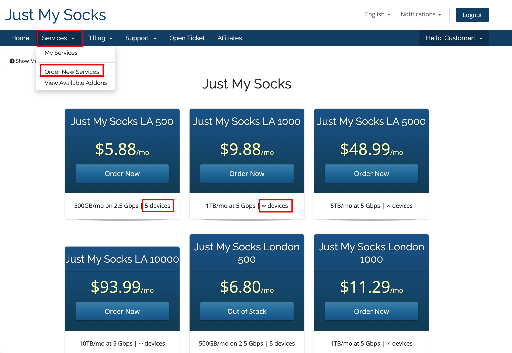
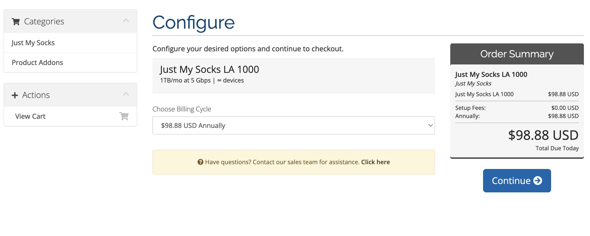
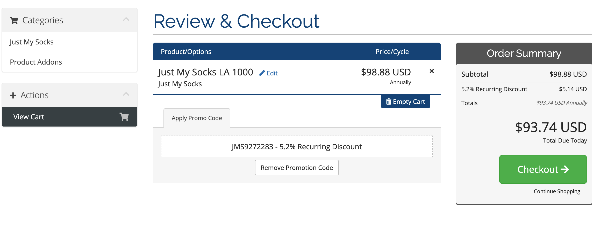
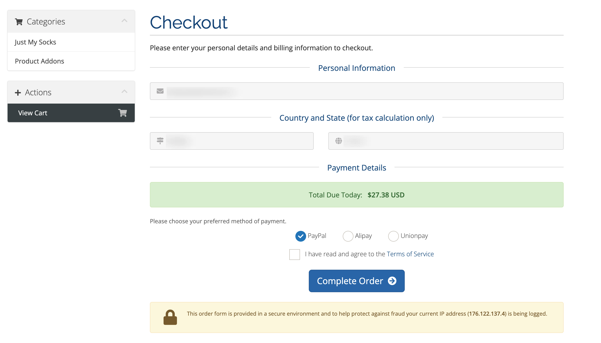
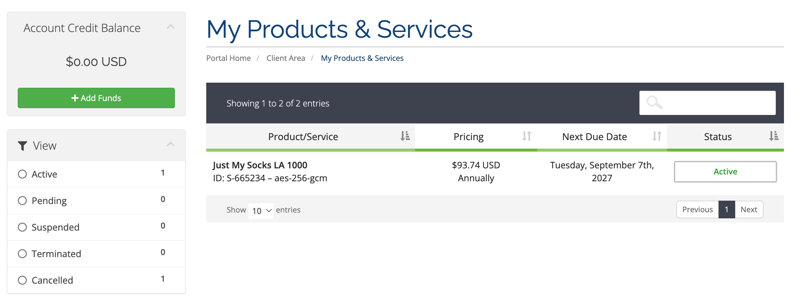
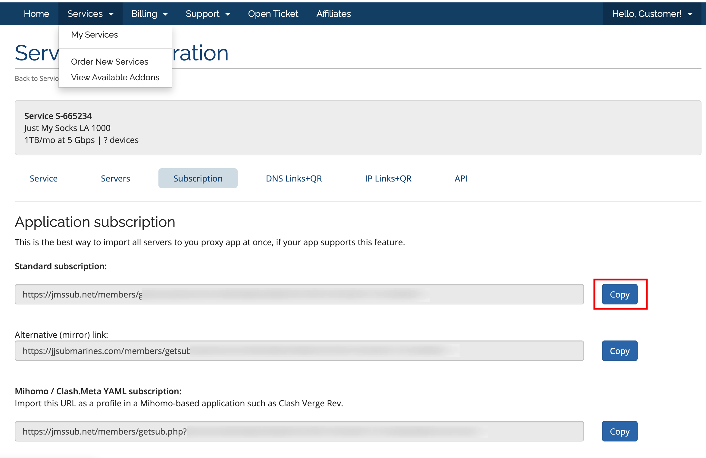
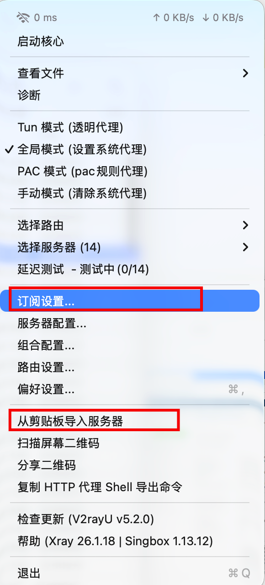
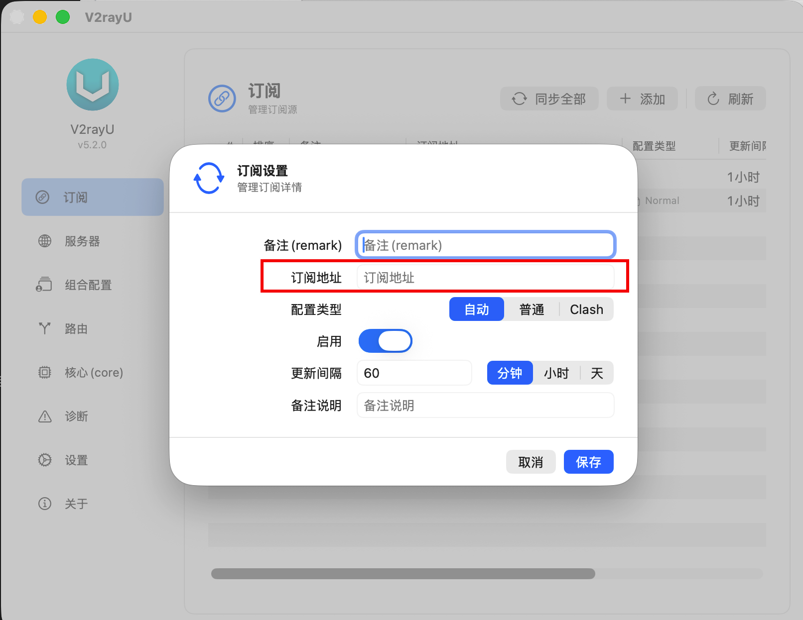

# 2026 Just My Socks 注册购买教程：套餐选择、付款与首次配置

## 购买前先准备好

你需要准备：

1. 一个可以正常使用的邮箱，用于账户登录和订单通知。
2. 支付方式，例如：支付宝、PayPal 或官网当前显示的其他方式。
3. 计划使用的设备。购买前要确认套餐是否限制手机、电脑或设备数量。

> 本站部分官网链接为推广链接。如果通过本站链接购买服务，本站可能获得佣金，但不会增加你的购买价格。

2026年 Just My Socks 注册购买完整教程，手把手教你选择套餐、使用优惠码 JMS9272283、完成账户注册与付款，并指导 Windows、Mac、Android 和 iPhone 用户配置 Shadowsocks 或 V2Ray 客户端，快速上手。

## 第 1 步：选择套餐和机房

在官方点击 **Service** → **Order New Services**，先查看套餐卡片中的信息。

包括：

- 月流量；
- 带宽或端口速率；
- 可用设备数量；
- 机房位置；
- 当前价格和计费周期。

不要只看价格，先确认套餐能覆盖你的使用设备，并查看支持多少个设备。

选择后点击 **Order Now**，进入订单确认页面。

## 第 2 步：确认计费周期和订单金额

在 **Choose Billing Cycle** 中选择购买周期。页面可能提供月付、季度、半年或年付等选项，具体以当前页面为准。

继续前检查：

1. 套餐名称和机房是否正确。
2. 设备限制是否符合需要。
3. 计费周期是否正确。

确认无误后点击 **Continue**。

## 第 3 步：应用优惠码

在订单页面找到优惠码输入框，输入官方优惠码：`JMS9272283`，再点击确认或应用。

优惠码区分大小写，并且可能有适用套餐、周期或时间限制。是否有效以及折扣金额，应以结算页最终显示为准。

确认折扣已经显示后，点击 **Checkout** 进入注册和付款页面。

## 第 4 步：填写注册信息并付款

在注册页填写真实、可验证的账户信息：

1. 输入常用邮箱。
2. 设置并确认账户密码。
3. 按实际情况填写姓名、地址和省份等字段。
4. 国家/地区选择与你实际信息相符的选项，例如中国大陆用户选择 **China**。
5. 选择官网当前支持的付款方式，例如 **Alipay**、**PayPal** 或 **UnionPay**。
6. 阅读并勾选服务条款，完成验证码。

最后点击 **Complete Order**，按页面提示完成付款。付款成功后，先回到账户后台确认服务状态。

## 第 5 步：进入后台查看服务信息

付款完成后：

1. 返回 Just My Socks 官网并登录。
2. 如果需要中文界面，使用右上角的语言切换。
3. 打开菜单中的 **Services → My Services**。
4. 点击刚购买的服务，进入服务详情页。
5. 找到 **Subscription** 或订阅相关区域，也可以按页面说明单独导入节点。
6. 复制页面提供的订阅链接之一。

订阅链接属于账户私密信息，只用于导入自己的客户端，不要发布到评论区或公共页面。

## 第 6 步：下载对应客户端

在 [Just My Socks 软件官方下载链接](https://justmysocks6.net/zh-cn/knowledge/software-download-links/) 中，根据自己的设备下载 Windows、macOS、iOS 或 Android 对应的客户端。

## 第 7 步：在 V2Ray 客户端中导入订阅并连接

本文使用 V2Ray 作为客户端示例；macOS 用户可以使用 V2RayU。完成安装后：

1. 打开 V2Ray 客户端。
2. 将第 5 步复制的订阅链接粘贴到订阅地址中。
3. 或复制单个节点，选择 **从剪贴板导入服务器**。
4. 选择一个节点，点击 **启动核心**，等待连接完成。
5. 访问 Google 或其他常用网站，验证连接是否正常。

不同客户端的按钮名称和界面可能不同，请以当前版本为准。协议是否适合你的网络环境，也应以实际连接结果为准。

## 常见问题

### 订阅链接不能公开吗？

不能。订阅链接通常包含服务配置或访问凭据，泄露后可能导致流量被他人使用或账户被滥用。

### 导入后无法连接怎么办？

先确认订阅链接复制完整、客户端版本正常、系统代理已打开，并尝试更换当前套餐中的其他节点或协议；仍无法连接时，再查看服务状态和官方故障说明。

### 价格或优惠码与文章不一样怎么办？

以当前官网套餐页和结算页为准。套餐、价格、库存、付款方式和优惠活动可能随时调整。
